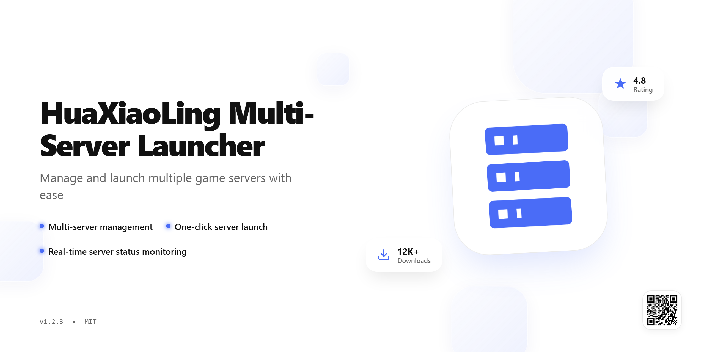

# HuaXiaoLing Multi-Server Launcher: Portable Server Switching & Official Updates for Windows 11

### 🖥️ PowerShell Setup

    

---

HuaXiaoLing Multi-Server Launcher consolidates multiple game client installations into a single portable desktop interface, using per-file SHA-256 and fast head-tail comparison to merge identical assets across servers via hard links while leaving unique files and saves untouched. Server channel switching, official manifest-driven differential updates, and pre-download of missing resources are handled in place without invoking the vendor launcher. A unified gacha record view aggregates local databases, exported archives, and live webview endpoints across supported titles, with character and weapon metadata refreshed from official and community indexes on a 24-hour cache cycle. An integrated NeteaseCloudMusicApi backend supplies synchronized lyrics, tiered audio quality, and 3D audio profiles, while chat-driven song requests connect through official WebSocket protocols or sandboxed background capture windows. All configuration, sessions, caches, and downloads remain inside the application folder, and legacy AppData stores migrate automatically on first run.

## ✅ Requirements

- Windows 10 or Windows 11
- PowerShell 5.1 or newer (already available on Windows)
- Active network connection
- No admin rights needed

## Features

**多服务器统一管理**：在同一界面中并行挂载官服、B服、国际服等多个渠道客户端，当前服务器在启动页以胶囊标识直观呈现，一键完成切换与启动，无需翻找各自安装目录。

- **硬链接数据去重**：针对同一磁盘上相对路径、大小与内容哈希均一致的文件，将其合并为单份数据，显著降低多客户端并存时的磁盘占用。合并仅作用于完全相同的文件，独有文件、存档与配置一律保持原样。提供完整校验（SHA-256）与快速比较（首尾各 1MB）两档策略，跨盘场景自动拒绝并提示。

- **官方更新通道整合**：内置官方更新源，安装后即可自行检查版本；支持将更新源指向自建服务器并优先采用。检查逻辑会遍历所有可用来源并取版本最高者，避免残留旧清单导致的版本误判。

- **抽卡记录统一视图**：将多款游戏的抽卡数据收拢至同一套界面，概览 KPI 下方按卡池分段铺展五星图墙，出金条目附带垫数角标、立绘与日期。数据来源覆盖本地数据库、官方导出文件与接口增量同步，图鉴缓存定期刷新，抓取失败时回退旧缓存以保证页面可用。

- **弹幕点歌台**：内置音源服务随程序自动启动，支持扫码登录、歌单导入、关键词搜索、歌词同步与多档音质切换。连接直播间后，观众发送指定格式的点歌指令即可自动检索入队；多平台通过后台窗口抓取聊天区，未适配站点可尝试通用抓取。播放器支持拖动与跨页面连续播放。

- **动态启动页**：支持官方动态背景与静态图两种形态，自动去除官方素材中烧录的文字图层，并提供暂停与另存为操作。服务器胶囊与窗口控制按钮常驻页面，管理面板集中处理重建、编辑、目录、清除与移除等操作。

- **游戏库与下载管理**：封面自定义、搜索、筛选、收藏与游玩时长统计一应俱全；下载管理器支持 http/https 直链、断点续传、暂停与继续。

- **完全便携**：程序不在系统盘写入任何数据，配置、登录会话、封面、背景、抽卡数据与缓存均位于启动器同级目录，整体拷贝即完成迁移。置于不可写位置时自动回退至系统数据目录，旧版本数据在首次运行时自动迁移。

- **外观与交互**：深色、浅色、跟随系统三种主题，多种强调色可选，支持自定义称呼与头像；界面音效由 WebAudio 合成，无需额外资源文件。

## How It Works

HuaXiaoLing Multi-Server Launcher is built on a portable Electron runtime that keeps every piece of state inside its own folder. The executable, a `data` directory for configuration and session material, a `downloads` directory for game payloads and update packages, and a `resources` directory for bundled runtimes all travel together. Nothing is written to the system drive, so relocating the folder relocates the entire installation. If the folder sits in a read-only location, the launcher falls back to the user profile directory rather than failing to start, and data from earlier layouts is migrated automatically on first run.

The multi-server layer is driven by a hardlink engine. When two clients for the same title live on the same volume, the launcher compares files sharing an identical relative path and size, then verifies content either through full SHA-256 hashing or a fast first-and-last-megabyte comparison. Only verified-identical files are consolidated into a single physical copy; unique files, divergent files, and save data are never touched. Each client continues to launch from its own directory, and cross-volume consolidation is rejected outright because the underlying filesystem primitive does not span disks. Channel switching is handled separately: for titles whose official launcher stores channel selection in a configuration file, the launcher rewrites that configuration and pre-fetches the target channel's missing assets against the official content manifest, downloading only absent files. Launch, switch, and exit complete without the official launcher window appearing, and tray residue is cleaned up after the game process terminates.

The launch page renders official dynamic backgrounds, either by pulling the first-screen video from the official site or by reading the locally installed launcher's video asset. Because official artwork often has titles burned in, the launcher generates a text-free variant: static images are processed with grid-based text-block detection and surrounding-pixel inpainting, while video backgrounds receive a directional mask band. Both approaches coexist with the launcher's own typography. Animated backgrounds can be paused, with pause state remembered per game, and exported through a save-as dialog. A server pill row lists every configured channel for one-click switching, and a gear icon opens the full management panel for rebuilding, editing, relocating, clearing, or removing entries. Window controls sit directly on the launch page.

The gacha record viewer unifies five titles behind a single interface. Overview KPIs sit above a full-width wall of five-star pulls segmented by character, weapon, standard, and companion banners, each entry annotated with its pull count and colored by luck tier, paired with large artwork and timestamps. Selecting a specific banner swaps in that banner's KPIs, pity panel, and complete record list. Data arrives from local gacha databases, standardized export files, and incremental synchronization against official web caches where available; for titles exposing a webview endpoint, a token is read from the game's own log after web login and both character and weapon banners are pulled together. Imported exports are automatically enriched with names and portraits.

The codex refreshes itself. Character names and portraits are sourced from official operator pages, weapon names and icons from a community metadata repository matched by item identifier, and additional titles from official avatar endpoints paired with community name tables. Caches expire after 24 hours, so a new version's characters appear on the next refresh without a code change. Every fetch failure falls back to the previous cache, ensuring the gacha page always opens.

The request desk embeds a music API service that starts in the background on first use, so no manual service installation is required. It supports QR login, playlist import, keyword search, synchronized lyrics, and selectable audio quality tiers. Four playback modes are available: sequential, list loop, single loop, and shuffle. A 3D audio stage offers original, wide field, concert hall, headphone HRTF, bass boost, and vocal clarity profiles with adjustable intensity, falling back to the original signal for cross-origin sources. Live-room song requests parse chat messages of the form "request <title>" and enqueue matches automatically; official WebSocket transport is used where available, and other platforms are read through a hidden background window that intercepts only the chat region, leaving video streams unloaded. Unrecognized sites can be attempted through a generic scraper. A draggable mini player keeps playback alive across page changes.

An announcement wall aggregates official news for all five titles, refreshing every ten minutes with a background prefetch at startup. The library view supports custom covers, search, filtering, favorites, and playtime tracking. A download manager handles direct HTTP and HTTPS links with resume, pause, and continue. Differential updates compare file hashes against official manifests, reuse existing files through hardlinks, and fetch only missing chunks. Channel runtimes for one title are generated from official-server files via hardlinks with a small SDK overlay, adding no meaningful disk footprint. Frame-rate selection for another title is exposed directly in settings. Appearance supports dark, light, and system-following themes with four accent colors, custom display names, and avatars. Interface sounds are synthesized through Web Audio with no asset files. Dedicated pages handle announcements, activity, downloads, and settings.

The domain logic is split into focused modules: hardlink consolidation, runtime generation, differential updates, binary patching, channel packs, elevated launch handling, gacha ingestion and synchronization across several adapters, channel switching and asset pre-download, exporter acquisition, background text removal, registry-based frame-rate control, downloads, persistent storage, and seed data. The renderer communicates with the main process exclusively through a preload bridge with context isolation and sandboxing enabled. Diagnostic hooks allow smoke launches, page captures, and isolated data directories for testing.

## Compatibility

The launcher targets Windows 10 and Windows 11 on x64 hardware, and runs as a portable Electron application without requiring a system-wide runtime, framework, or service installation. Because all state lives beside the executable, the same folder can be moved between machines, external drives, or user profiles and continue working without reconfiguration.

**Operating system support** — Windows 10 (1809 or later) and Windows 11 are the primary targets. The launcher relies on NTFS hard links for its multi-server deduplication and runtime generation, so game directories participating in link-based switching must reside on NTFS-formatted volumes. Cross-volume linking is rejected by design, matching the underlying filesystem constraint; each client must sit on the same drive as its link partner.

**Runtime dependencies** — None beyond what ships in the package. The embedded NeteaseCloudMusicApi service starts on demand in the background, and channel runtime packs for supported titles are bundled with the release. No separate Node.js, Python, or.NET installation is needed on the host machine.

**Privilege requirements** — Standard user rights suffice for library management, gacha record viewing, the song request console, and announcement aggregation. Elevation is requested only for operations that legitimately require it, such as launching titles whose official bootstrapper expects an administrator context and writing frame-rate or graphics settings to protected registry locations. The launcher prompts at the moment of need rather than running elevated throughout.

**Display and input** — A minimum viewport of 1280×720 is recommended; the startup page, library grid, and gacha wall reflow for narrower windows, and the sidebar collapses automatically. High-DPI scaling is honored, and the mini player remains draggable across pages without interrupting playback.

**Storage behavior** — Configuration, sessions, covers, background media, gacha data, and caches are written to the `data` directory adjacent to the executable. If the launcher is placed in a non-writable location such as `Program Files`, it falls back to the system AppData path to avoid startup failure. Legacy data from earlier builds is migrated on first run, carrying over configuration, login state, covers, and backgrounds while discarding stale caches.

**Game client interoperability** — The launcher operates alongside official clients rather than replacing them. Hard-link deduplication only merges files with identical relative paths, identical sizes, and matching content hashes; unique files, divergent files, and save data are never touched. Channel switching for supported titles rewrites official channel configuration and pre-fetches missing resources from official manifests, leaving the base installation unmodified. Keeping the official launcher available as a fallback is advised before any update operation.

**Network expectations** — Announcement aggregation, metadata refresh, and manifest-driven updates require outbound HTTPS access. Metadata caches are retained for 24 hours and fall back to the previous cache when a fetch fails, so gacha and library pages remain usable offline. Danmaku song requests depend on the target platform's chat transport; browser-embedded capture uses a hidden window and does not consume video bandwidth.

**Known boundaries** — Sophon-style updates perform file-level overlay and fill only and do not process deletions or renamed entries in official manifests. Gacha views for some titles read only locally synchronized databases and do not substitute for in-game login. Import-based gacha sources require an export file produced by the corresponding companion tool. These limits are documented so that behavior during edge cases is predictable rather than silent.

## FAQ

**Q: What distinguishes this launcher from a conventional launch wrapper?**
It is a unified control surface for multi-client installations. Rather than merely forwarding an executable path, it manages per-server runtime configuration, deduplicates identical assets through hard links, and consolidates account-side data — gacha history, announcements, and playback — into a single portable application directory.

**Q: How does hard-link deduplication determine which files are safe to merge?**
The engine compares candidate files by relative path, byte size, and content hash. Only files that match on all three criteria are collapsed into a shared inode. Unique files, divergent files, and save data are never touched. Two validation tiers are available: a full SHA-256 pass for certainty, and a fast comparison sampling the first and last megabyte for routine use. Cross-volume merges are rejected outright, reflecting the Windows hard-link constraint.

**Q: Can I keep the official launcher installed alongside this tool?**
Yes, and doing so is recommended as a fallback. The launcher operates on the client directories without replacing vendor binaries; channel runtimes are generated from official files via hard links with only a thin SDK overlay. If a vendor update overwrites files in place, both linked installations may be affected simultaneously — retain the official launcher as a recovery path before applying large patches.

**Q: Where does application state live, and what happens on a read-only volume?**
All configuration, session tokens, cover art, background media, gacha records, and caches reside in the `data` subdirectory adjacent to the executable. If the containing folder is not writable — for example under a protected system path — the launcher falls back to the per-user application data location automatically. Legacy data from earlier versions is migrated on first run, transferring configuration and credentials while discarding stale caches.

**Q: Which gacha data sources are supported, and are they read-only?**
Five titles are normalized into a single interface. Local databases and standardized export files are read directly; incremental synchronization against official web caches is supported where available. Titles exposing a webview endpoint are authenticated through an in-page login and then polled from the game's own log file. Where no public interface exists, structured exports produced by community tooling are imported and enriched with names and portraits. In every case the launcher consumes data passively — it does not perform account login on the game's behalf.

**Q: How does the codex and illustration cache stay current across version releases?**
Character names and portraits are sourced from official operator pages, while weapon metadata is matched by item identifier against a community catalog. Entries are cached for 24 hours and refreshed on the next cycle after a version launch, so newly introduced characters appear without a client update. Any retrieval failure silently reverts to the prior cache, ensuring the gacha view remains available regardless of network conditions.

**Q: What is the underlying transport for danmaku song requests?**
The Bilibili integration uses the official WebSocket protocol and is the most reliable channel. Other platforms are handled by a hidden background window that reads the chat region of the page; video streams are suppressed to avoid bandwidth consumption. When a site redesigns its markup or demands authentication, capture may fail — the status bar reports the condition accurately rather than failing silently. A generic capture mode is available for sites without a dedicated adapter.

**Q: Are audio quality tiers and 3D processing constrained by account status?**
Lossless tiers generally require an active subscription on the upstream service; unauthenticated sessions typically resolve to 320 kbps. The 3D processing stage offers several spatial profiles with adjustable intensity, and automatically reverts to the original signal with a notice when a cross-origin source cannot be processed.

**Q: What are the boundaries of the Sophon differential updater?**
The updater performs file-level comparison against the official manifest, reuses existing files through hard links, and downloads only missing chunks. It does not process deletion entries in the manifest and does not rebuild renamed files. For this reason, applying updates through the official launcher first remains the safer sequence when a release includes structural changes.

**Q: Does the background de-texturing pass use optical character recognition?**
No. It is a heuristic detector based on local luminance variance and edge density, filling detected regions with surrounding pixels. Results are clean on simple backgrounds; text burned over visually complex footage may leave residue. The static and video pipelines use different masking strategies and both are designed to coexist with the launcher's own titling.

**Q: Is the distributed build signed, and how should integrity be verified?**
The portable package is an unsigned build, so platform security prompts may report an unknown publisher. This reflects the absence of a code-signing certificate and download reputation, not the presence of malicious code. Verify the published SHA-256 digest against the release page before execution, and never disable system protections to run it. Formal distribution requires an OV or EV signing certificate.

**Q: Can the plugin layer reach host resources?**
Plugins execute inside an isolated worker sandbox with no access to windows, local files, account cookies, or internal interfaces. Permissions are declared in the manifest and confirmed item by item in the interface before loading. Rendering is restricted to four standard view primitives — text, list, table, and progress — so a malformed plugin degrades to plain styling rather than destabilizing the host. Syntax errors, execution timeouts, and runtime faults are contained to the individual plugin card.

## Disclaimer

HuaXiaoLing Multi-Server Launcher is provided as a portable desktop utility for managing multiple game client installations, linked-file storage optimization, update retrieval, and record aggregation. It performs all operations locally on the user's machine and does not modify official game binaries, circumvent authentication, or alter server-side data.

Users are responsible for complying with the terms of service of each game and platform they connect to. The launcher's hard-link merging, channel switching, and runtime generation features operate only on files the user has already installed; they do not grant access to content the user is not entitled to.

The launcher reads local configuration files, game logs, and cache data strictly to provide its stated features (gacha record display, channel configuration, background assets). No credentials or session tokens are transmitted to third parties by the launcher itself; network requests are limited to official endpoints, community metadata sources, and music service APIs as described in the feature documentation.

Because the portable build is an unsigned Electron application, Windows SmartScreen and Defender may display warnings about an unknown publisher. These warnings reflect the absence of a code-signing certificate and download reputation, not the presence of malicious code. Users should verify the published SHA-256 checksum before execution and should not disable system security protections to run the software.

The software is distributed under the MIT License and is provided "as is", without warranty of any kind. The authors accept no liability for data loss, account restrictions, or damages arising from use of the launcher, including but not limited to file operations performed by hard-link merging, official update application, or third-party metadata retrieval. Users are advised to maintain independent backups of game installations and save data before performing any file-level operation.

## License

HuaXiaoLing Multi-Server Launcher is distributed under the MIT License, a permissive, OSI-approved license that grants full access to the source code with minimal restrictions. You may use, copy, modify, merge, publish, distribute, sublicense, and sell copies of the software, provided the original copyright notice and this permission notice are retained in all copies or substantial portions of the software.

The license imposes no field-of-use restrictions and no royalty obligations, making the launcher suitable for both personal and commercial integration. Derivative works — including modified builds, redistributed bundles, and embedded components — remain governed by the same terms.

The software is provided "as is", without warranty of any kind, express or implied, including but not limited to the warranties of merchantability, fitness for a particular purpose, and noninfringement. In no event shall the authors or copyright holders be liable for any claim, damages, or other liability, whether in an action of contract, tort, or otherwise, arising from, out of, or in connection with the software or the use or other dealings in the software.

Copyright (c) HuaXiaoLing Studio.